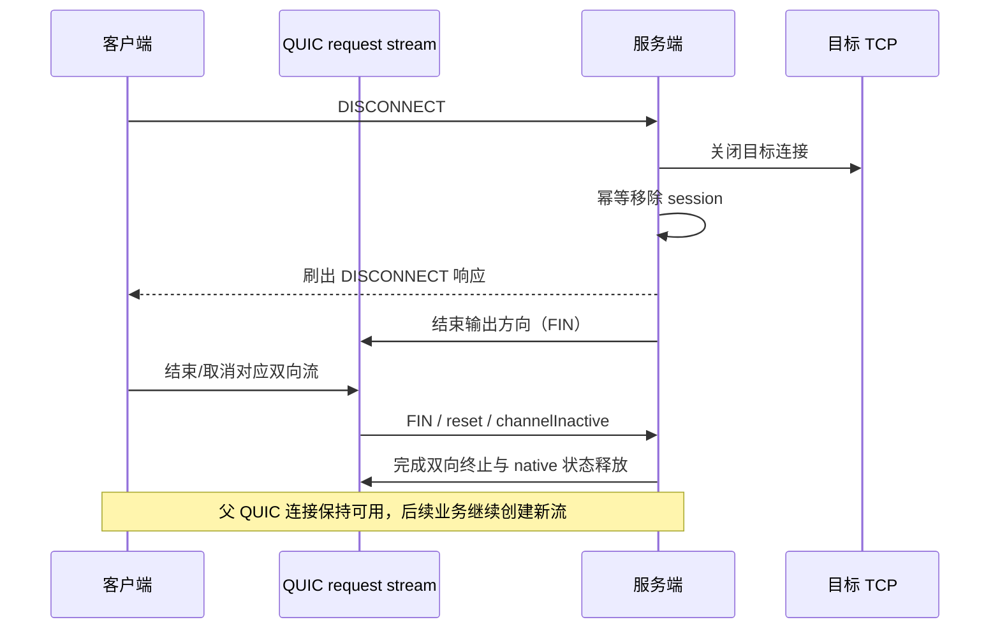

# HTTP/3 Stream 生命周期修复与时间轮兜底

> 2026-10-20 · 针对 `cc55154` 诊断基线实施的本地修复。线上服务未切换。
>
> 修复前证据见 [Stream 额度耗尽复现报告](http3-stream-limit-investigation.md)。本文说明修复后的关闭规则、资源归属与验证方法。

## 1. 修复目标

在同一条 QUIC 连接中反复建立、关闭业务流，结束的流应及时归还协议额度，并释放浏览器关联、远端 session、目标 TCP 和未完成控制请求。正常的空闲长连接不因定时清理而断开。

此次不实施节点选择改造，不更换加密协议，不提高 stream 上限，也不通过定期重连父 QUIC 连接掩盖问题。

## 2. 关闭流程



普通 `Channel.close()` 和删除 Java Map 条目并不足以证明原生 QUIC 状态释放。正常终止应先刷出最后的响应，再结束输出；应用放弃流、错误或回收时显式终止双向 QUIC 状态。

| 结束原因 | 修复后的处理 |
|---|---|
| 正常 DISCONNECT | 服务端关闭目标及 session，发送响应后结束输出；客户端控制请求完成后关闭对应流 |
| 输入 FIN | 先把事件传给解码器检查截断记录，再结束本端流；不等待 channel 自然失活 |
| CONNECT 拒绝或超时 | 客户端取消控制请求并清理对应 stream，服务端失败响应后结束输出 |
| 目标 TCP EOF/异常 | 移除 session，发送流级 DISCONNECT 并结束输出，保留此前已排队的最终 DATA 的发送顺序 |
| 浏览器在 CONNECT 等待期间关闭 | 取消该 CONNECT 与其超时任务，关闭在途 stream；不继续替浏览器建立目标连接 |
| stream 尚在异步创建时取消 | 失败状态保留到创建回调检查，迟到 channel 立即终止，不恢复发送 |
| 目标连接迟到成功 | session 已关闭或入站已断开时拒绝激活，并关闭新建的目标 Channel |
| QUIC 父连接丢失 | 逐流失败与清理，控制请求只影响该客户端，不全局失败其他客户端 |

远端正常 DISCONNECT 引起的目标关闭不会再重复发送目标 EOF 通知。所有 session 关闭操作幂等，避免两个关闭来源互相递归。

## 3. 两层时间轮兜底

### 3.1 HTTP/3 stream 兜底

`Http3StreamHandler` 使用一个共享、守护线程的 `HashedWheelTimer`：

| 项目 | 行为 |
|---|---|
| 时间轮 tick | 100ms，512 个槽 |
| 默认检查间隔 | 10 秒 |
| 调度方式 | 每条 stream 注册可取消任务，状态检查交回该 stream 的 EventLoop |
| 回收条件 | 输入或输出已经 shutdown，但 stream 尚未完整退出 |
| 回收动作 | 显式终止双向状态，然后关闭 Channel |
| 健康连接 | 双向均未结束时重新安排检查，不因“多久没有业务数据”回收 |
| 任务结束 | channelInactive 或 handlerRemoved 时取消任务；EventLoop 已停止时不继续调度 |

测试可通过 URL 内部参数 `http3.streamCleanupIntervalMs` 缩短间隔，生产默认不需要新增 YAML 配置。该参数尚未作为统一的 Http3Config YAML 字段对外开放。

时间轮是关闭事件遗漏的保底，不代替 QUIC 自身的网络失活检测。双向仍显示正常、实际网络黑洞的连接仍依赖传输 idle/连接超时识别；不能用 stream 清理任务无差别杀掉正常长连接。

### 3.2 服务端 session 兜底

`SessionManager` 将原有定期扫描从调度线程池改为 `HashedWheelTimer` 驱动，默认仍每 10 秒执行一次：

- 正常路径绑定入站 `closeFuture`，关闭 stream 时立即移除 session 并关闭目标连接。
- session 自身关闭时通过条件移除回调注销，旧会话的迟到回调不会误删替代会话。
- 保底扫描 CLOSED session、入站已失活的 session，以及 ACTIVE 但目标 Channel 已失活的 session。
- 扫描不依据业务空闲时长，不关闭健康的空闲 session。
- 服务停机时停止时间轮并关闭剩余 session；停止期间不再重排任务。

该层仍是定期扫描，扫描成本与 session 数量相关；使用时间轮调度并不意味着扫描本身变成 O(1)。stream 层共享时间轮也不会为每个流创建一条线程。

## 4. 相关代码改动

| 位置 | 改动 |
|---|---|
| `Http3StreamHandler` | 输入 FIN、应用 close 与双向 native 终止；共享时间轮及任务取消 |
| `Http3Client` | 取消/失败终止双向流；拒绝 DATA/DISCONNECT 为不存在的流另起一个 stream；异步创建检查取消状态 |
| `MessageHandler` | 增加默认流级关闭回调，不引入新的集群或业务依赖 |
| `ExchangeHandler` | 跟踪自身客户端的控制请求；单流关闭只失败对应请求与浏览器关联；终止响应写出后再结束输出 |
| `HeaderExchangeClient` | CONNECT 超时/拒绝清理，浏览器取消关联，发送失败上报，关闭回调注册在实际发送之前 |
| `DefaultFuture` | 外部取消/异常完成同样注销全局请求记录、取消原超时任务 |
| `OutboundSession` / `OutboundHandler` | 目标 EOF 通知、幂等关闭、迟到连接拒绝，最终 DATA 与终止通知保持提交顺序 |
| `OutboundConnector` / `DispatchInvoker` | 取消在途目标连接，超时后关闭迟到连接，关闭会话不再错误激活 |
| `SessionManager` | closeFuture 即时清理、条件移除、时间轮扫描 |
| `NettyClient` | HTTP/2 共享控制路径上的取消建流同步保护，迟到 stream 不恢复发送 |

HTTP/3 transport 测试的新 stream 首条消息同步改为 CONNECT，保留原有 payload 校验和 51 条 stream 的独立性验证。CONNECT 后 DATA 的真实 Exchange 流程仍由独立集成测试覆盖。

## 5. 验证

### 5.1 真实上限复测

在 Linux 原生 QUIC、JDK 17 下，以兼容的 `chacha20` 套件、服务端上限 1000，保持同一条父 QUIC 连接，串行执行正常 CONNECT/DISCONNECT：

| 指标 | 修复前诊断 | 本次复测 |
|---|---:|---:|
| 计划连接数 | 1100 | 3000 |
| 完成连接数 | 1000，第 1001 次失败 | 3000，全部完成 |
| 目标 TCP 同时活跃峰值 | 1 | 1 |
| 结束时客户端活跃 stream | 0 | 0 |
| 结束时服务端 request stream | 1000 | 0 |
| 结束时服务端 session / 目标 TCP | 0 / 0 | 0 / 0 |
| 剩余可建双向流额度 | 0 | 994 |

额度为采样瞬间值，不要求立即等于 1000；本次没有重连父 QUIC 来重置额度，也没有增加上限。

### 5.2 关闭、取消与保底测试

显式诊断矩阵扩展为 10 种场景：正常断开、直接关传输流、目标主动关闭、CONNECT 拒绝、CONNECT 超时、原 FIN 对照、强制 reset、遗漏 FIN 事件的时间轮兜底、健康空闲流、异步建流时取消。

其中时间轮用例会在服务端故意吞掉输入 FIN 通知，客户端只 shutdownOutput，服务端不执行正常 FIN 回调。通过 100ms 检查间隔验证保底回收；健康空闲用例保持连接超过多个检查周期，断言它仍可用。取消建流场景允许 CONNECT 尚未到达服务端，重点验证迟到 stream 不复活。

新增 `SessionLifecycleTest` 覆盖关闭后目标迟到成功、入站关闭立即释放目标、遗漏目标关闭回调时的扫描兜底；`StreamFailureIsolationTest` 覆盖单流/单客户端错误隔离、浏览器取消及已关闭浏览器不再触发发送。

原有三套件出站大数据测试加强为 `2MiB + 1` 字节回传后目标立即 EOF，逐字节校验最终 DATA 不被关闭流程截断。

### 5.3 运行方式

最终客户端及服务端模块完整回归发现 **173 项，170 项通过、0 失败、0 错误、3 项跳过，BUILD SUCCESS**。跳过项为手动运行的旧向量生成器，以及两项需要显式设置 `PROXY_TEST_SYSPROXY` 才运行的真实系统代理测试；外网 Baidu 测试通过选择表达式明确排除，不计入这 173 项。

该回归包含全部 10 种显式生命周期场景，每种 24 次、上限 8，结束资源断言均通过；其中主动关闭、健康空闲与时间轮漏事件用例也已覆盖。累计 3000 次的真实上限复测为另一次独立执行，不混入普通单测数量。未以重复运行留下的 JaCoCo 数据计算覆盖率结论。

最后对目标关闭测试补充了等待客户端异步 stream 清理完成的条件，并定向重编译、重跑 `none`、`chacha20-poly1305-v2`、`aes-gcm-v2` 三个继承用例：**3 项通过、0 失败**，日志为 `fix-target-close-final.log`。

普通测试默认保留正常断开额度回收回归；完整诊断矩阵需显式开启：

```bash
mvn -B -pl proxy-local,proxy-remote -am test \
  '-Dtest=!BaiduProxyTest' -Dsurefire.failIfNoSpecifiedTests=false \
  -Dhttp3.lifecycle.probe=true \
  -Dhttp3.lifecycle.limit=8 -Dhttp3.lifecycle.cycles=24
```

真实 3000 次循环：

```bash
mvn -B -pl proxy-remote -am test \
  '-Dtest=Http3OutboundIntegrationTest#streamCreditsMustBeRecycledWithSequentialConnections' \
  -Dsurefire.failIfNoSpecifiedTests=false \
  -Dhttp3.lifecycle.probe=true -Dhttp3.lifecycle.limit=1000 \
  -Dhttp3.lifecycle.cycles=3000 -Dhttp3.lifecycle.mode=disconnect \
  -Dhttp3.lifecycle.cipher=chacha20
```

原始日志在本地 `.build/quic-lifecycle/`，包括 `fix-3000-chacha20.log` 和 `fix-full-regression.log`。复现报告保留修复前数据，不将历史失败结果改写成通过。
